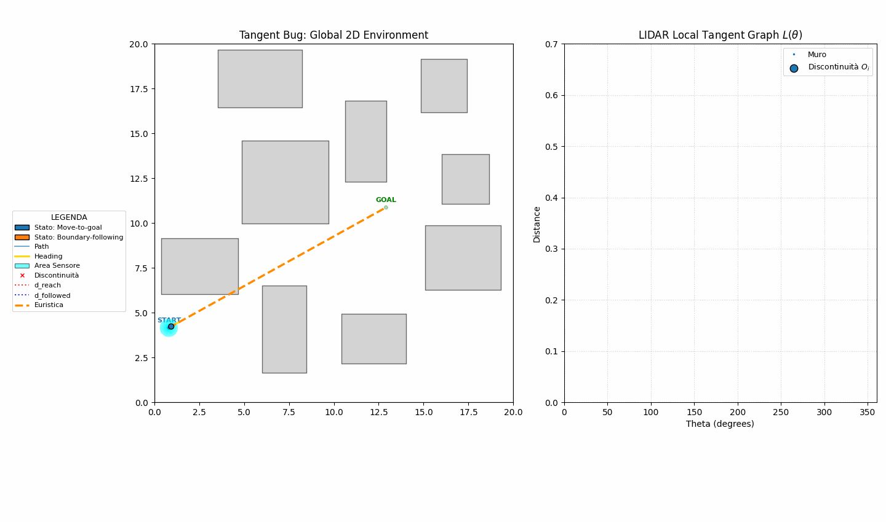
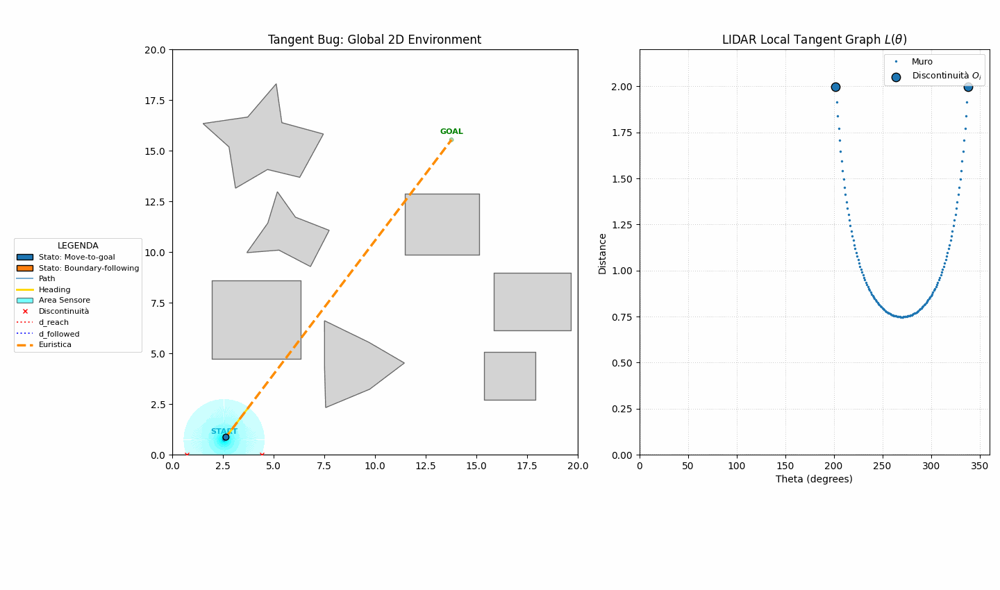
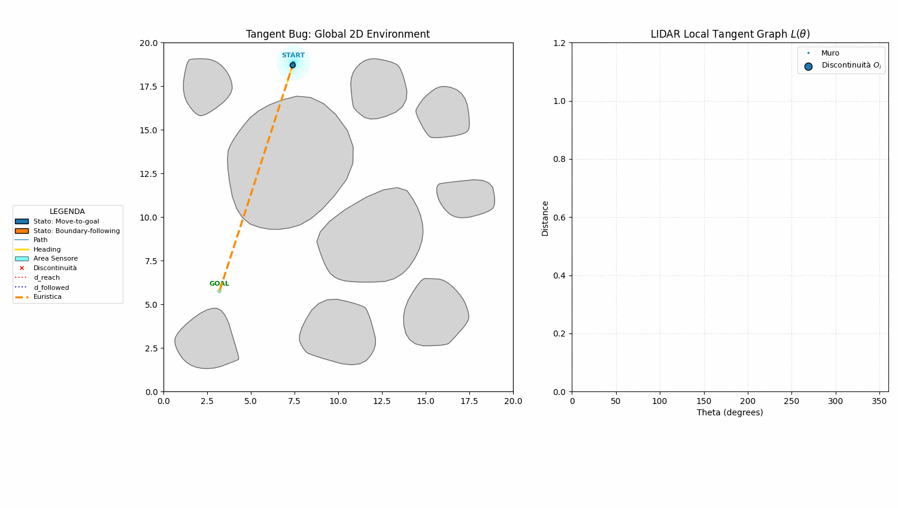
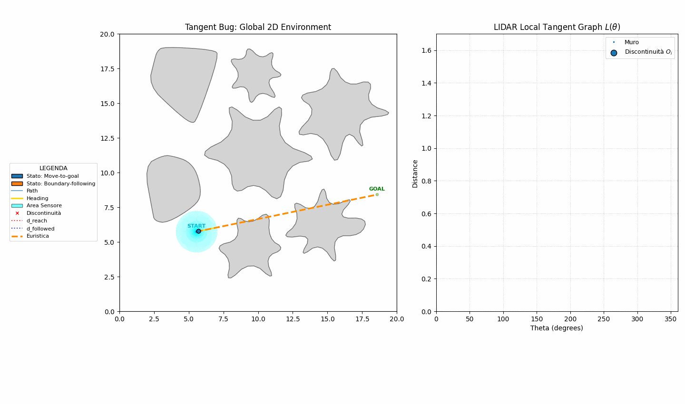

# Tangent Bug: Autonomous Navigation Simulation

*Master's Project Work | University of Florence | 2026* · [Versione italiana](README_IT.md)

<p align="center">
  
</p>

This project implements a 2D simulation environment for the **Tangent Bug** navigation algorithm. The robot has a sensor (similar to a LiDAR) and has to reach a goal moving through an environment full of randomly generated obstacles.

All the simulation parameters (robot size, sensor range, number of obstacles, speed, etc.) can be changed easily from the `config.py` file.

## Main features

* **Two-state logic:** the robot switches by itself between two behaviors to find the way:
  * *Move-to-Goal*: the robot moves straight to the goal, or to the visible edge that brings it closer.
  * *Boundary-Following*: if the robot ends up in a dead end (local minimum), it starts following the perimeter of the obstacle to go around it.
* **Random but safe maps:** the map is generated at every run. Obstacles are placed randomly but never on top of the start or the goal.
* **Simulated sensor:** the robot computes the distances from the obstacles in real time and finds the free edges to understand where it can pass.
* **Real-time graphics:** the interface shows the 2D map, the sensor view (local tangent graph) and a panel with all the data in real time (distances, current state of the robot).
* **Automatic export:** when the robot reaches the goal, the simulation saves a GIF of the trajectory in the `media/` folder.

## Algorithm (pseudo-code)

**Repeat behavior 1: move to goal**

1. Compute the discontinuity points $O_k$.
2. Move to the goal if it is reachable, otherwise move to the discontinuity point with the minimum heuristic distance $h_k(q)$.

*Until:*
* the goal is reached, or
* the minimum heuristic distance $h_k(q)$ starts to increase.

**Repeat behavior 2: boundary following**

1. Compute the discontinuity points $O_k$ and the distances $d_{\text{reach}}$ and $d_{\text{followed}}$.
2. Follow the boundary keeping the same direction used before.

*Until:*
* the goal is reached, or
* a full loop is completed (the goal can't be reached), or
* $d_{\text{reach}} < d_{\text{followed}}$.

## Results

The `showcase/` folder contains the GIFs of the tests, grouped by type of obstacle. The file name tells the parameters used: `Seed` (map), `SR` (sensing range), `Radius` (robot radius) and `Rays` (number of LiDAR rays).

| Rectangles | Concave polygons |
|---|---|
|  |  |
| **Convex blobs** | **Concave blobs** |
|  |  |

### Changing the parameters

In `showcase/mixed/` the same map is run with different sensor settings, to see how the path changes:

| Map | Sensing range | LiDAR rays | GIF |
|---|---|---|---|
| Seed 67 | 1.0 | 360 | [Prova 1](showcase/mixed/seed%2067/Prova_1_TB_Seed67_SR1.0_Radius0.1_Rays360.gif) |
| Seed 67 | 1.0 | 180 | [Prova 13](showcase/mixed/seed%2067/Prova_13_TB_Seed67_SR1.0_Radius0.1_Rays180.gif) |
| Seed 67 | 1.0 | 90 | [Prova 12](showcase/mixed/seed%2067/Prova_12_TB_Seed67_SR1.0_Radius0.1_Rays90.gif) |
| Seed 67 | 1.5 | 360 | [Prova 11](showcase/mixed/seed%2067/Prova_11_TB_Seed67_SR1.5_Radius0.1_Rays360.gif) |
| Seed 67 | 2.0 | 360 | [Prova 2](showcase/mixed/seed%2067/Prova_2_TB_Seed67_SR2_Radius0.1_Rays360.gif) |
| Seed 89 | 1.0 | 360 | [Prova 7](showcase/mixed/seed%2089/Prova_7_TB_Seed89_SR1_Radius0.1_Rays360.gif) |
| Seed 89 | 1.5 | 360 | [Prova 15](showcase/mixed/seed%2089/Prova_15_TB_Seed89_SR1.5_Radius0.1_Rays360.gif) |
| Seed 89 | 2.0 | 360 | [Prova 8](showcase/mixed/seed%2089/Prova_8_TB_Seed89_SR2_Radius0.1_Rays360.gif) |
| Seed 89 | 2.0 | 180 | [Prova 9](showcase/mixed/seed%2089/Prova_9_TB_Seed89_SR2_Radius0.1_Rays180.gif) |
| Seed 89 | 2.0 | 90 | [Prova 14](showcase/mixed/seed%2089/Prova_14_TB_Seed89_SR2.0_Radius0.1_Rays90.gif) |

## Project structure

```
tangent-bug-planner/
├── main.py             start the program from here
├── config.py           all the settings of the world and of the robot
├── requirements.txt
├── src/
│   ├── simulation.py   simulation loop (moves the robot and updates the screen)
│   ├── robot.py        the "brain" of the robot and its motion rules
│   ├── worldgen.py     creates the map and the obstacles
│   ├── geometry.py     math and collision checks
│   ├── sim_render.py   graphics on screen
│   ├── sim_playback.py saves the GIF animation
│   └── sim_types.py    data containers for the simulation state
└── showcase/           GIFs of the tests
```

## How to run

Tested with Python 3. A virtual environment (`venv` or `conda`) is recommended.

```bash
git clone https://github.com/masileonardo/tangent-bug-planner.git
cd tangent-bug-planner
pip install -r requirements.txt
python main.py
```

A window opens with the simulation. When the robot reaches the goal, the GIF is saved in `media/`.

To try a different map or sensor, change the values in `config.py`, for example:

| Parameter | Meaning | Default |
|---|---|---|
| `SEED` | map generated (same seed, same map) | `89` |
| `NUM_OBSTACLES` | number of obstacles | `10` |
| `SENSING_RANGE` | range of the sensor | `1.5` |
| `LIDAR_NUM_RAYS` | number of LiDAR rays | `360` |
| `ROBOT_RADIUS` | radius of the robot | `0.1` |
| `STEP_SIZE` | distance covered at each step | `0.15` |

## Tools

Python, NumPy, Matplotlib, Pillow

## Team

Group project developed with my classmates for the AAIR course of the Master's degree in Robotics, Automation and Electrical Engineering, University of Florence.

## Contact

Leonardo Masi

- Portfolio: https://masileonardo.github.io/#tangent-bug
- LinkedIn: https://www.linkedin.com/in/leonardo-masi-b09b28219/
